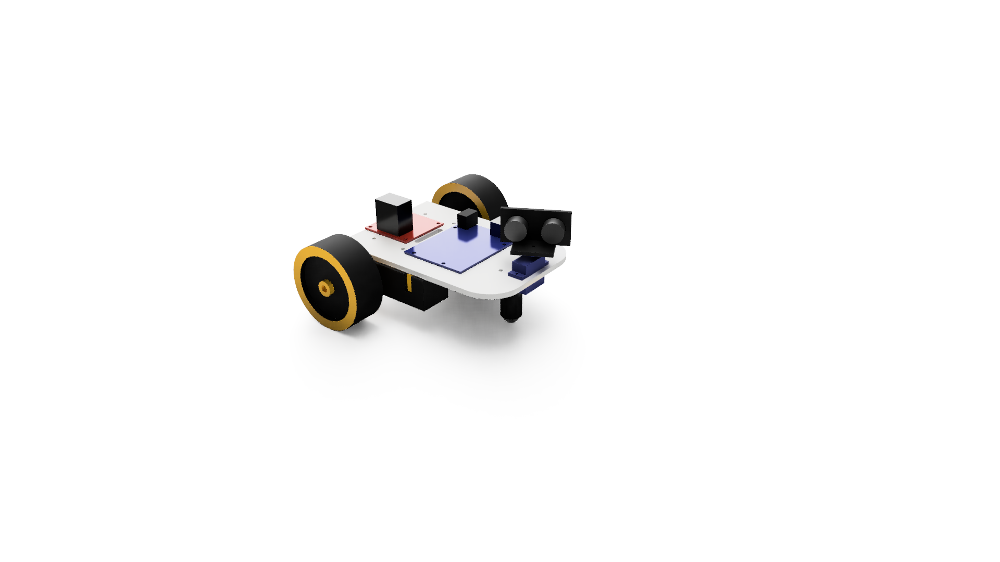

# 🤖 Obstacle-Avoiding Robot – Chassis Redesign

A mechanical redesign of a 2WD obstacle-avoiding robot, replacing the generic acrylic kit chassis with a custom-designed, 3D-printable chassis.

Designed entirely in **Autodesk Fusion**, the assembly is built around the actual dimensions and mounting patterns of the electronic and mechanical components. The project focuses on accurate component integration, design for 3D printing, mechanical clearances, and assembly validation.

## 📸 Final Assembly

## 🧩 Components Used

| Component | Specifications |
|---|---|
| Arduino Uno | Standard Uno R3 mounting pattern (Ø3.2 mm, M3) |
| L298N Motor Driver | 43 × 43 mm, mounting holes on a 37 mm square |
| TT Gear Motors (×2) | 1:48 ratio, 70 × 22 × 18 mm, double shaft |
| Wheels (×2) | 65 mm diameter |
| HC-SR04 Ultrasonic Sensor | Mounted on a servo-driven scanning mechanism |
| SG90 Micro Servo | Mounted through a dedicated chassis cutout |
| Ball Caster | 12.7 mm ball diameter |

## 🛠️ Custom 3D-Printable Parts

All custom mechanical components were designed in Autodesk Fusion with dimensions based on the actual hardware.

### 1. Chassis Plate
- Overall dimensions: **100 × 150 × 4 mm**
- R25 front corner radius
- 16 mounting holes
- Dedicated servo cutout
- Wire-routing slot
- Component mounting positions based on actual hole patterns

### 2. Motor Cradles (×2)
- Outer dimensions: 76.4 × 26.4 × 24.4 mm
- Motor pocket: 70.4 × 18.4 × 22.4 mm
- 0.2 mm print clearance
- Symmetrical front-to-back design, allowing one model to be used on both sides
- Ø2.8 mm holes for self-tapping M3 screws
- Mounting holes spaced 30 mm apart
- Shaft clearance notches on both ends

### 3. Ball Caster Mount
- Total height: **43.5 mm**
- Designed around an 11 mm axle depth below the chassis plate
- Accounts for the 32.5 mm wheel radius
- Maintains a level robot chassis

### 4. Ultrasonic Sensor Bracket
- L-shaped mounting bracket
- Base: 30 × 20 mm
- Vertical wall: 50 × 26 mm
- Two Ø16.4 mm sensor openings
- 26 mm spacing between sensor openings
- Designed to attach to the SG90 servo horn

## ⚙️ Assembly & Motion

The complete robot was assembled in Autodesk Fusion using appropriate mechanical joints.

| Component | Joint Type |
|---|---|
| Motor cradles | Rigid |
| TT Gear Motors | Rigid |
| Arduino Uno | Rigid |
| L298N Motor Driver | Rigid |
| Ball Caster | Rigid |
| SG90 Servo | Rigid |
| HC-SR04 Sensor | Rigid |
| Wheels (×2) | Revolute |
| Sensor Bracket | Revolute |

### Motion Study

The motion study demonstrates:
- Both wheels rotating around their motor shafts.
- Ultrasonic sensor assembly scanning from **−90° to +90°**.
- Independent wheel and sensor movement within the assembled robot.

## 🔍 Interference Analysis & Design Improvements

Interference analysis was used to identify and correct mechanical assembly issues.

| Issue | Analysis | Solution |
|---|---|---|
| Motor sitting too deep inside cradle | 3638 mm³ interference; approximately 2.9 mm equivalent offset | Corrected the joint alignment after identifying an incorrect snap reference |
| Motor interfering with cradle side wall | 2466 mm³ interference; approximately 1.6 mm equivalent offset | Shifted motor position by 2 mm and corrected the pocket alignment |
| Ball caster intersecting chassis plate | 1252 mm³ interference; approximately 3.1 mm equivalent offset | Corrected the caster joint reference to the underside of the chassis |

**Final result: Zero interference in the complete assembly.**

## 🎬 Project Demonstration

| Deliverable | Description |
|---|---|
| [Robot Render](Robot_render.png) | Photorealistic final assembly render |
| [Motion Study](Robot_motion.mp4) | Wheel rotation and sensor scanning |
| [Assembly Drawing](Robot_drawing.pdf) | Engineering drawing with parts list (PM-ROB-001, Rev A) |

## 📁 CAD Files

| File | Format | Description |
|---|---|---|
| [Robot_Assembly.f3z](Robot_Assembly.f3z) | Fusion Archive | Complete Autodesk Fusion assembly |
| [Robot_Assembly.step](Robot_Assembly.step) | STEP | CAD model compatible with other CAD software |
| [Robot_drawing.pdf](Robot_drawing.pdf) | PDF | Assembly engineering drawing |
| [Robot_render.png](Robot_render.png) | PNG | Final photorealistic render |
| [Robot_motion.mp4](Robot_motion.mp4) | MP4 | Assembly motion study |

The STEP assembly can also be used to export individual custom parts for 3D printing.

## 💡 Skills & Tools

**Software:**
- Autodesk Fusion

**Engineering Skills:**
- Mechanical CAD Design
- Design Around Real-World Components
- Design for Additive Manufacturing (3D Printing)
- Mechanical Assembly and Joint Constraints
- Revolute and Rigid Joints
- Interference Detection and Analysis
- Motion Studies
- Photorealistic Rendering
- Engineering Drawings and Documentation

## 🚀 Future Improvements

- 3D print the custom chassis and mounting components.
- Assemble and test the redesigned robot.
- Validate motor alignment, chassis stability, and sensor movement.
- Develop a simulation in Webots.
- Explore ROS 2 integration for robot navigation and obstacle avoidance.

## 📚 CAD + Robotics Portfolio

This project is **Project 03 of a 5-project CAD + Robotics portfolio**.

| Project | Description |
|---|---|
| [Project 01 – Battery Module](../01-battery-module-4s2p/) | 4S2P battery module design |
| [Project 02 – Robot Gripper](../02-robot-gripper/) | Robotic gripper design |
| **Project 03 – Obstacle-Avoiding Robot** | Custom chassis redesign |

---

**Author:** Prithvi Mishra  
**Project:** 03 / 05 – CAD + Robotics Portfolio  
**Date:** November 2026

*Designed in Autodesk Fusion with a focus on mechanical accuracy, manufacturability, and practical robotics integration.*
