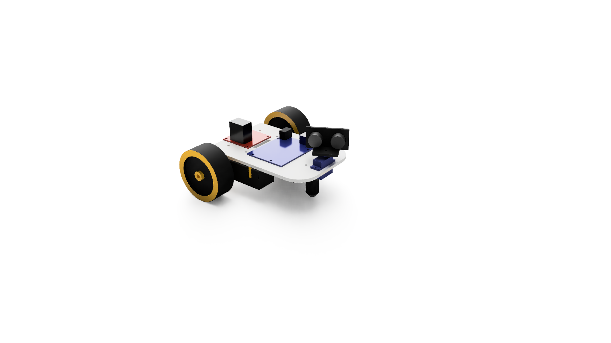

# ⚙️ Fusion CAD Portfolio

CAD projects designed in **Autodesk Fusion** as part of my EV + Robotics learning journey. Each project builds on previous engineering skills, progressing toward a **ROS 2-controlled robotic arm**.

## 📂 Projects

| # | Project | Highlights | Status |
|---|---|---|---|
| 1 | [4S2P 18650 Battery Module](01-battery-module-4s2p/) | Multi-part assembly, interference & section analysis, BMS mount, vented enclosure | ✅ Completed |
| 2 | [Parallel-Jaw Robot Gripper](02-robot-gripper/) | Rack & pinion, revolute + slider joints, motion links, motion study | ✅ Completed |
| 3 | [Differential-Drive Robot Chassis](03-robot-chassis/) | Real component dimensions, custom 3D-printable chassis, motor cradles, motion study, interference analysis | ✅ Completed |
| 4 | EV Motor Mount + Gear Reduction | Gear design, mechanical assembly, stress simulation (FEA) | ⬜ Planned |
| 5 | 3-DOF Desktop Robot Arm | Joint limits, URDF export, ROS 2 / Webots integration | ⬜ Planned |

## 🖼️ Project Gallery

| Battery Module | Robot Gripper | Obstacle-Avoiding Robot |
|---|---|---|
|  |  |  |
| [View Project 01](01-battery-module-4s2p/) | [View Project 02](02-robot-gripper/) | [View Project 03](03-robot-chassis/) |

## 📦 Project Deliverables

Each project aims to include:

- 📸 Photorealistic CAD render
- 🎬 Motion study or exploded-view animation
- 📄 Engineering drawings (ISO A3, with parts list)
- 📦 Autodesk Fusion archive (`.f3z`) and STEP files
- ✍️ Detailed README documenting design decisions, specifications, and problems solved

## 🛠️ Skills & Tools

**Software:**  
Autodesk Fusion · Webots · ROS 2 · MATLAB

**Engineering Skills:**
- Parametric Part & Assembly Design
- Mechanical Joints and Motion Links
- Rack & Pinion Mechanisms
- Design for Additive Manufacturing (3D Printing)
- Interference Detection and Analysis
- Section Analysis
- Motion Studies and Animation
- Photorealistic Rendering
- Engineering Drawings and Technical Documentation

## 🎯 Roadmap

- [x] Project 01 – 4S2P Battery Module
- [x] Project 02 – Parallel-Jaw Robot Gripper
- [x] Project 03 – Differential-Drive Robot Chassis
- [ ] Project 04 – EV Motor Mount + Gear Reduction
- [ ] Project 05 – 3-DOF Desktop Robot Arm
- [ ] Integrate robotic arm with ROS 2 and Webots

## 👨‍💻 About Me

Engineering student (Semester 3) interested in **Electric Vehicles, Mechanical Design, and Robotics**.

Currently developing practical engineering skills through CAD projects, mechanical assemblies, simulation, and robotics software.

**Author:** Prithvi Mishra
